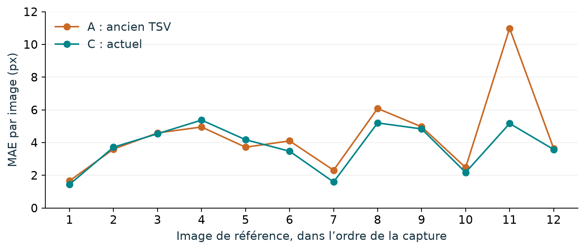

# TSV : détection du couloir ferroviaire et de l’axe médian

Projet **LBIR2234 - Data Sciences PEPPS**. Le programme segmente la voie parcourue, calcule ses deux limites et leur milieu dans l’image, puis exporte une vidéo et des CSV pour l’équipe gabarit.

**État du 18 octobre 2026 : prototype expérimental hors ligne.** Les 12 images TSV servent au développement ; les mètres restent conditionnels. Ce dépôt contient le code, les tests, les configurations réutilisables et les résultats agrégés. Les vidéos, annotations, GPS et poids entraînés doivent être obtenus séparément dans l’espace de travail autorisé du groupe.

## Lire dans cet ordre

1. [Installation et premières commandes](docs/DEMARRER.md)
2. [Comment le programme fonctionne](docs/METHODE.md)
3. [Résultats, graphes et limites](docs/RESULTATS.md)
4. [Interface CSV avec l’équipe gabarit](docs/INTERFACE_GABARIT.md)
5. [Travailler à plusieurs](CONTRIBUTING.md)
6. [Catalogue des programmes](docs/CATALOGUE_PROGRAMMES.csv)

## Méthode retenue

- **PyTorch + segmentation_models_pytorch, DeepLabV3+ avec encodeur ResNet50**.
- MPS sur Mac Apple Silicon si disponible ; CPU sinon.
- Couloir entre les faces intérieures visibles, `background=0`, `couloir=1`, `ignore=255`.
- Entrée VGA 640 × 480 avec conservation du rapport d’aspect ; coordonnées exportées dans l’image d’origine.
- Préapprentissage RailSem19 générique, puis annotations publiques ego-path, puis adaptation sur 130 annotations TSV reviewed.
- Extraction des limites et du milieu, contrôles géométriques et temporels, signalement des absences et ambiguïtés.

Le « modèle public ego-path » comparé est **notre DeepLab entraîné avec les annotations publiques ego-path** ; ce ne sont pas les poids officiels TEP-Net.

## Résultats principaux

| Indicateur | Résultat | Périmètre |
|---|---:|---|
| Erreur d’axe ancien → actuel | 4,42 → 3,77 px, soit -14,7 % | 12 images de développement, 1 171 sections communes ; moyenne par image |
| Dice TSV ancien → actuel | 96,56 → 97,27 % | Recouvrement du couloir sur 12 références |
| Erreur de la livraison V3 | 3,82 px | 1 229 sections disponibles ; moyenne des erreurs par image |
| Test externe figé | 96 images | Couverture des sections : 94,22 % frontales, 0 % latérales, 77,48 % total |
| Équivalent métrique d’erreur | 2,48 cm si G=1,067 m | Conversion conditionnelle ; aucune validation physique en 3D |



Les 3,77 et 3,82 px utilisent des supports différents. Les points voisins d’une image sont corrélés ; ils ne représentent pas autant d’expériences indépendantes. L’erreur d’une frame sans référence est inconnue, pas nulle. Voir les [dénominateurs et explications](docs/RESULTATS.md).

## Installation rapide

Python 3.12 est l’environnement de développement testé. Depuis ce dépôt :

```bash
python3.12 -m venv .venv
source .venv/bin/activate
python -m pip install -r requirements.txt -r requirements-plots.txt
python -m pip install --no-deps -e .
python -m railtsv.cli --help
python -m pytest -q
```

Sur Windows, activer `.venv\Scripts\Activate.ps1`. Les commandes d’inférence exigent un checkpoint réel : le dépôt ne télécharge pas automatiquement vos données ou vos modèles. Les fichiers `requirements*-lock.txt` décrivent l’environnement historique testé ; pour reproduire cet environnement exact, voir [DEMARRER](docs/DEMARRER.md).

## Organisation

```text
railtsv/      Réseau, données, apprentissage, géométrie, temps et métriques
scripts/      Commandes et protocoles expérimentaux datés
tests/        Tests logiciels avec données construites pour les tests
configs/      Conventions d’annotation et paramètres sans calibration active
examples/     Formats d’entrée et exemple synthétique d’échange
results/      Chiffres agrégés et contexte, sans images/GPS sources
docs/         Explications, graphes et catalogue
data/         Vos données locales (non versionnées)
runs/         Vos checkpoints et résultats locaux (non versionnés)
```

Les scripts datés documentent les expériences historiques et attendent leurs entrées locales. Les commandes génériques sont détaillées dans le guide ; cloner le dépôt seul ne recrée pas les scores publiés sans données, annotations et checkpoints correspondants.

## Limites et droits

Il reste à mesurer le choix de la bonne branche aux aiguillages, à évaluer de nouvelles captures TSV indépendantes et à valider la calibration physique. Un rendu MP4 à 30 fps ne démontre pas un calcul en temps réel. VGA ne définit aucune échelle universelle pixel/mètre.

Voir [données et droits](docs/DONNEES_ET_DROITS.md). Aucune licence de redistribution du code du groupe n’a été choisie ici ; les bibliothèques et jeux de données conservent leurs licences propres.
