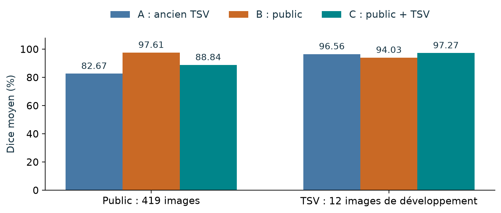
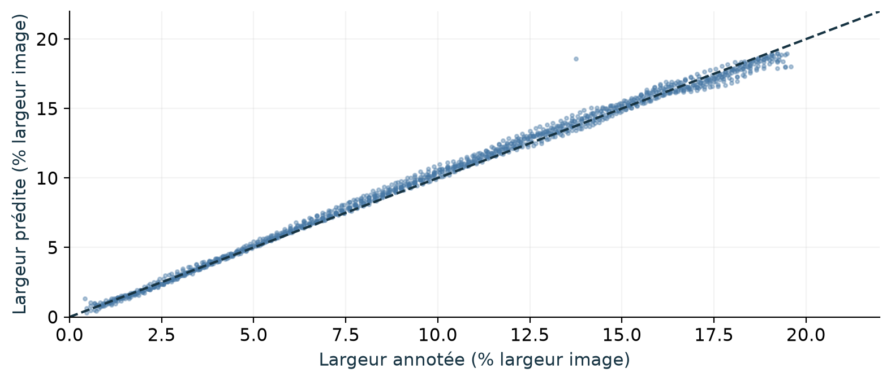
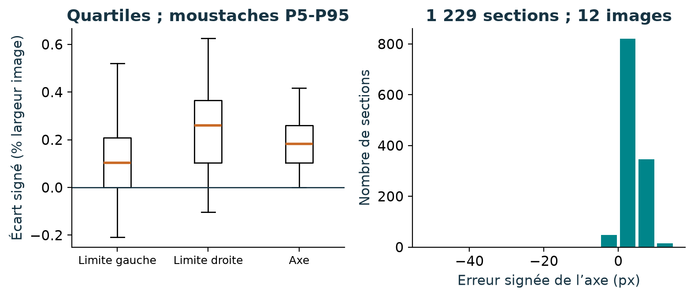
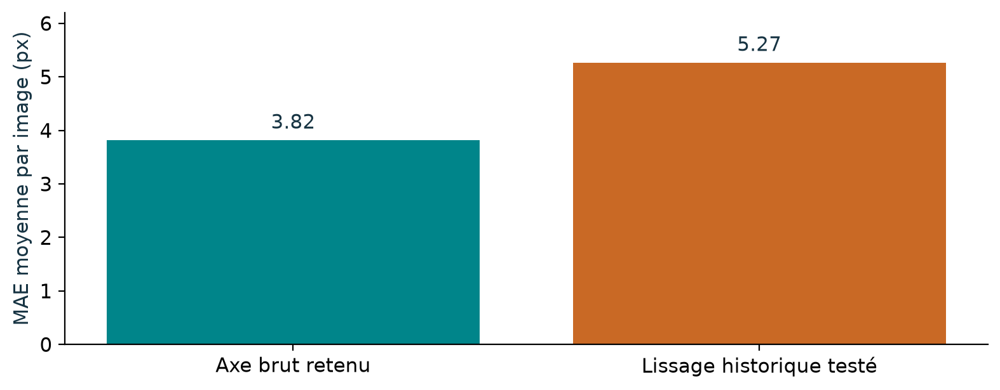
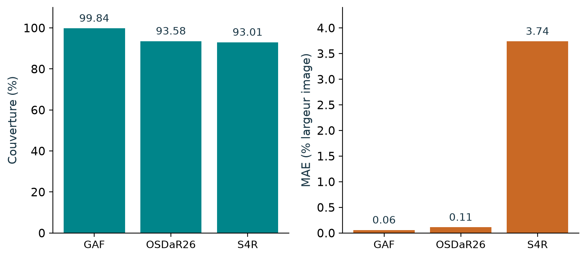
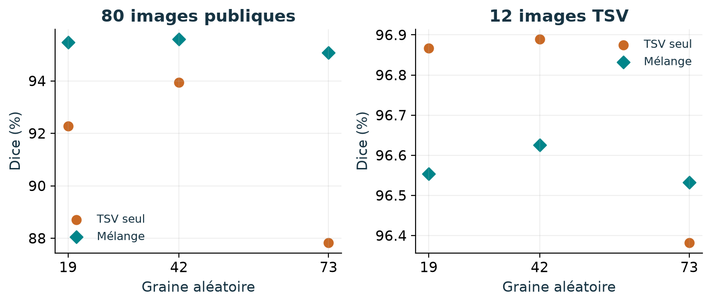
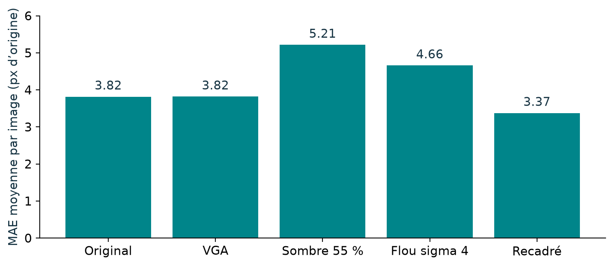
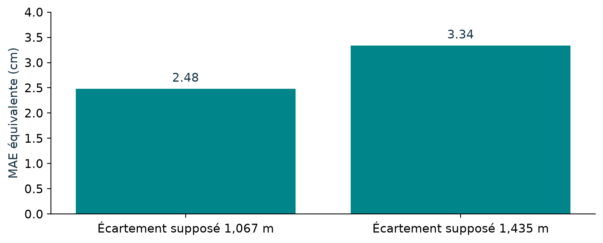

# Résultats et interprétation - bilan du 18 octobre 2026

Les valeurs ci-dessous ont été recalculées ou contrôlées à partir des résultats locaux. Le dépôt conserve les agrégats et figures ; les images, annotations, trajectoires et checkpoints restent hors dépôt. [Tableau chiffré](../results/RESULTATS_AGREGES.csv) · [Contexte](../results/CONTEXTE.json).

## Trois modèles comparés

A : ancien modèle TSV ; B : notre DeepLab entraîné sur les annotations publiques ego-path ; C : B adapté aux annotations TSV. Le modèle livré est C. Il n’existe pas de fusion arbitraire des sorties A/B/C dans la livraison retenue.

Sur 419 images publiques, Dice A=82,67 %, B=97,61 %, C=88,84 %. Sur 12 images TSV de développement, A=96,56 %, B=94,03 %, C=97,27 %. L’adaptation TSV améliore le domaine TSV mais conserve moins bien le public que B. Les cibles et les scènes diffèrent entre les domaines.

## Erreur de l’axe

Sur les 1 171 sections communes aux douze images : moyenne des MAE par image A=4,42 px, C=3,77 px, soit une baisse de 14,7 %. La onzième image contribue fortement au gain ; toutes les images ne progressent pas.

Sur l’ensemble des 1 229 sections disponibles de la V3, la moyenne par image vaut 3,82 px ; en regroupant les sections, MAE=3,79 px, RMSE=4,66 px et biais=+3,61 px. Les nombres diffèrent à cause du support et de l’agrégation, pas d’une précision physique différente.

## Largeur et décalage

Un point compare les deux largeurs sur une ligne y. La diagonale représente l’égalité. Le modèle retrouve bien la largeur apparente sur ces références, mais les deux limites peuvent se décaler ensemble en gardant la bonne largeur. Les points sont corrélés au sein d’une image.

La boîte contient les 50 % centraux ; les moustaches de cette figure vont de P5 à P95. Elles ne sont pas des intervalles de confiance. Le décalage positif va vers la droite. L’histogramme conserve les grands écarts, dont un résidu de -52,5 px.

## Stabilité

Le lissage historique donne 5,27 px d’erreur moyenne par image contre 3,82 px pour l’axe brut sur les mêmes références : il n’est pas retenu dans la V3. Un autre filtre sur TSV_record réduit la variation entre observations d’environ 2,1 %, mais sans référence temporelle cela ne prouve pas une meilleure précision. Évaluer ensemble erreur, couverture, vibration et retard.

## Test externe figé

96 images publiques, modèle et liste figés avant inférence ; aucune adaptation sur ces images. 71 images possèdent une référence éligible et 47 une erreur calculable. Couverture des sections : 77,48 % au total ; 94,22 % en frontal, 0 % en latéral. 37 des 38 vues latérales ne donnent aucun axe. La moyenne par image des erreurs mesurables est 1,79 % de la largeur source ; les absences ne sont pas comptées comme erreur zéro.

GAF : 99,84 % de couverture, MAE 0,057 % de largeur. OSDaR26 : 93,58 % et 0,111 %. S4R : 93,01 % et 3,739 %. Ces différences montrent une limite de transfert et de cadrage. Les références publiques suivent notamment les bords extérieurs, contrairement à la cible TSV intérieure. Les cas ambigus à plusieurs branches ne deviennent pas un score de bon itinéraire.

Le contrôle d’empreintes n’a trouvé aucun fichier identique avec les 3 130 images distinctes des manifests d’apprentissage contrôlés. Cela ne prouve pas l’absence de copies transformées ni l’indépendance de tous les trajets. Ce test externe ne remplace pas une nouvelle capture TSV réservée au test.

## Mélange public/TSV et graines

Trois graines (19, 42, 73), initialisation publique fixe et 780 mises à jour par bras. TSV seul : 780 exemples TSV ; mélange : 520 TSV + 260 publics. Le Dice public passe de 91,35 ± 3,16 % à 95,38 ± 0,27 % ; le Dice TSV passe de 96,71 ± 0,29 % à 96,57 ± 0,05 %. Les ± sont des écarts-types sur trois répétitions, pas des intervalles de confiance. Le pilote n’a pas remplacé automatiquement le modèle C.

## Dégradations et VGA

Sur les douze références connues : original 3,82 px, source VGA 3,82 px, luminosité à 55 % 5,21 px, flou sigma 4 px 4,66 px. Le recadrage donne 3,37 px et se compare justement à 3,79 px sur la même zone conservée. Ce sont des transformations d’anciennes images, pas un nouveau test indépendant. L’entrée du réseau était déjà VGA.

## Premiers mètres

Sur 1 139 sections convertibles, conversion des erreurs réelles en pixels avec la largeur humaine annotée : 2,48 cm de MAE équivalente moyenne par image si G=1,067 m ; 3,34 cm si G=1,435 m. Quatre-vingt-dix sections trop étroites sont exclues. Ces valeurs dépendent de l’hypothèse et ne mesurent pas une erreur physique de terrain. Le percentile 95 vaut 6,49 cm sous G=1,067 m ; il n’est pas une garantie à 95 %.

## Ce qui manque encore

Une nouvelle réserve de captures TSV, une référence de bonne branche aux aiguillages, une seconde lecture humaine de contours, des répétitions plus larges, une mesure du retard sur séquence et des contrôles physiques avec caméra/écartement confirmés. Le test externe déjà consulté ne doit pas servir indéfiniment à régler un modèle tout en gardant le nom de test indépendant.

Le Mac M4 a traité environ 7,1 à 7,3 images/s dans le benchmark hors ligne documenté. Les trois essais de 60 frames incluent la chaîne de calcul/CSV/encodage, pas la caméra ni l’affichage. Aucune démonstration de 30 fps caméra-écran n’est acquise.
